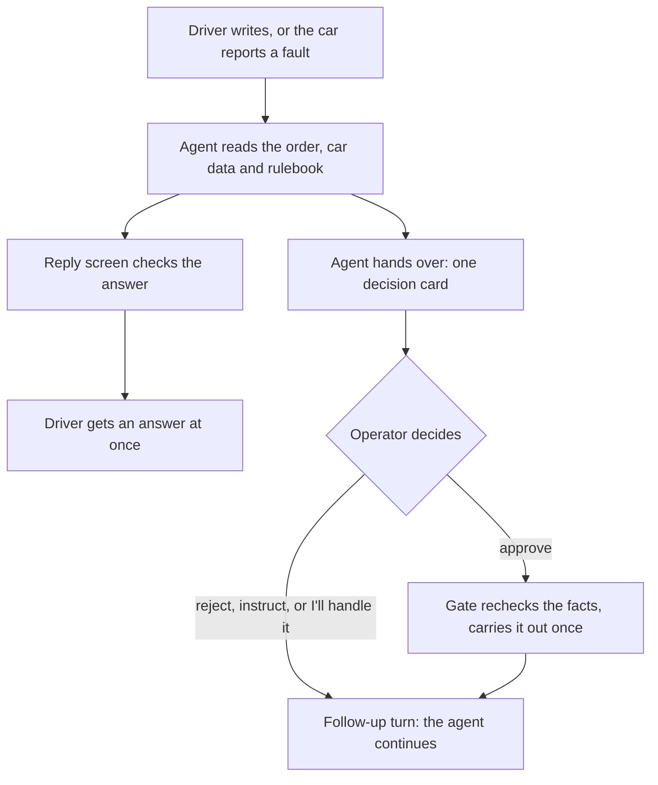

# Road Desk: the parts and how they work together

Road Desk is a prototype control room for Bahn's car deliveries. An AI agent does the first work on problems on the
road: it reads the records, asks the driver or the pickup place, and looks things up. When something needs a
decision, it brings a person one card with the facts and their sources. Everything is fictional and simulated.

## The parts

| Part | What it does |
|---|---|
| **Control room** (`starter/`) | The web app. Operators get a map of every delivery, **Needs you** (decisions, agent working, waiting), all orders, the order page with its card and timeline, and an inbox. Other roles: the driver's phone, the pickup desk, and a demo panel for scenarios, the clock and the customer's emails. |
| **Agent** (`starter/lib/agent/`) | A language model working in a loop with tools. Drivers and sites see less of the order than operations. Every tool call and card passes the **approval gate** (`gate.ts`), which holds the rules. Every message to a driver passes the **reply screen** (`drivability.ts`): word patterns, then a small model. |
| **Records** (`starter/lib/cr/`) | Our tables: cases, their timelines, decision cards, what was carried out (effects), car data. Effects are laid over the dataset, which never changes. |
| **Simulator** (`starter/lib/sim/`) | Moves cars on a simulated clock, writes phone positions and car readings, injects faults, runs scenarios A to H and the reset. |
| **Call service** (`dossier/`) | A separate local service. It builds an order "dossier" (every record about the order, graded by strength of evidence), prepares and simulates phone calls, reads transcripts and drafts inbox replies. The app works without it. |
| **Rulebook** (`starter/rulebook/`) | Nine plain-English playbooks, which the agent reads in full every turn. |
| **Dataset** (`dataset/`) | 100 fictional orders, plus 58 documents and photos in `attachments/`. |
| **Tests** | 128 tests against a test database, with no model. Two harnesses (`scripts/e2e-roles.ts`, `scripts/night/`) play every role with a real model and check what the records show. |

## Main flow: a driver reports a problem

1. A driver writes in the app, or the car reports a fault. On a fault the agent contacts the driver first.
2. The agent reads before it asks: the order, the car's codes, the guides, any photo. It may send a fixed safety
   instruction ("stop at the next safe place") at once.
3. Its answer passes the reply screen. If it reads as "you can drive on", it is held and rewritten once. If held
   again, the driver gets a fixed line and operations gets a "clear to drive on?" card.
4. When a person must decide (recovery, a booking, a new date, a cost), the agent hands over. An operations-side
   turn writes one card: what happened, sourced facts, unknowns, a recommendation, what happens next.
5. The operator approves (or edits the message first), rejects with a reason, instructs the agent, or picks
   "I'll handle it" and logs the outcome later.
6. On approval the gate rechecks what the card relied on. If a fact changed, nothing runs and the agent redrafts.
   Otherwise the action runs once, even after a double click.
7. A follow-up turn tells the driver, proposes the next step, or sets a wait with a check time.

## Other workflows

**A customer email.** The email lands on the case waiting for the customer, or a new one. The agent drafts the reply
as a card; a person sends it. If the customer agrees to a proposed new date, the email is not the record: the case
waits until a person presses **Customer agreed** (or declined). Only that moves the promise.

**A desk asks about the driver.** The server first checks the contact belongs to that order. The agent then sees only
its timing, the driver's first name, the car and the plate. A desk that is not the customer's gets its
answer at once; one that belongs to the customer gets it only after a person approves the card.

**From pickup to handover.** The driver reports each step in the phone: at the pickup, collected, checked in for the
ferry, at the delivery address, handed over to a named person. The server checks the driver and the order of steps.
Each step is laid over the snapshot, so every screen follows. Photos become the order's proof. The handover brings
one card: the delivery confirmation, for a person to send to the customer.

**The clock and the car data.** The clock starts at the snapshot (09:00 UTC, 21 October) and runs with real time;
the demo panel can jump it, and a restart catches it up to the newest record. Operator pages poll every few seconds:
each poll writes the car readings that fell due, then checks timers. A silent driver gets one reminder, then the agent
tries their phone; if nobody answers, a person gets a "call them" card. A case stuck as "agent working" for three
simulated minutes becomes a card. A heartbeat in the server does the same work when no page is open, and runs the
**autopilot**: the agent's own check-up calls (a quiet phone on a moving car, a ferry check-in closing, a pickup slot
with unverified access, a driver who has not started) through the call service, each recorded on the order's
timeline with what was said. A scenario started from the demo screen takes precedence on its order.

**A phone call.** Before a live call, the call service prepares the line with a brief and the whole dossier, and
refuses calls the agent may not make (a desk that belongs to the customer). The audio runs on a phone-line server
outside this repository. After hang-up the transcript becomes claims that cite exact turns, plus a review, shown on
the order. A live call does not start an agent turn. Simulated calls on the demo panel let the model play both sides.

## Safety rules, in code

- **Nothing is booked, sent to a customer or cleared to drive without a person.** Every action starts at "ask
  first", nothing in the app raises it, and customer contact is locked. Questions to drivers and non-customer desks
  need no approval.
- **One card at a time per case.** Exempt: cards the gate raises itself (a held clearance or reply), and the reply to
  someone who wrote and has had no answer.
- **An unknown outcome is reconciled, never retried.** A booking that timed out blocks new bookings on that order
  until a person checks with the provider and logs whether it exists.

## Where to look

| To find | Look in |
|---|---|
| When the agent runs; one turn | `starter/lib/agent/triggers.ts`, `loop.ts` |
| Tools; approval rules | `starter/lib/agent/tools.ts`, `gate.ts` |
| Timers and reminders | `starter/lib/agent/tick.ts`, `followup.ts` |
| Tables; an order with effects | `starter/lib/cr/schema.ts`, `effective.ts` |
| Delivery steps | `starter/lib/agent/milestones.ts`, `starter/lib/cr/lifecycle.ts` |
| Scenarios, car data, clock | `starter/lib/sim/scenarios.ts`, `sync.ts`, `starter/lib/cr/clock.ts` |
| Call service | `dossier/src/serve.ts` |
