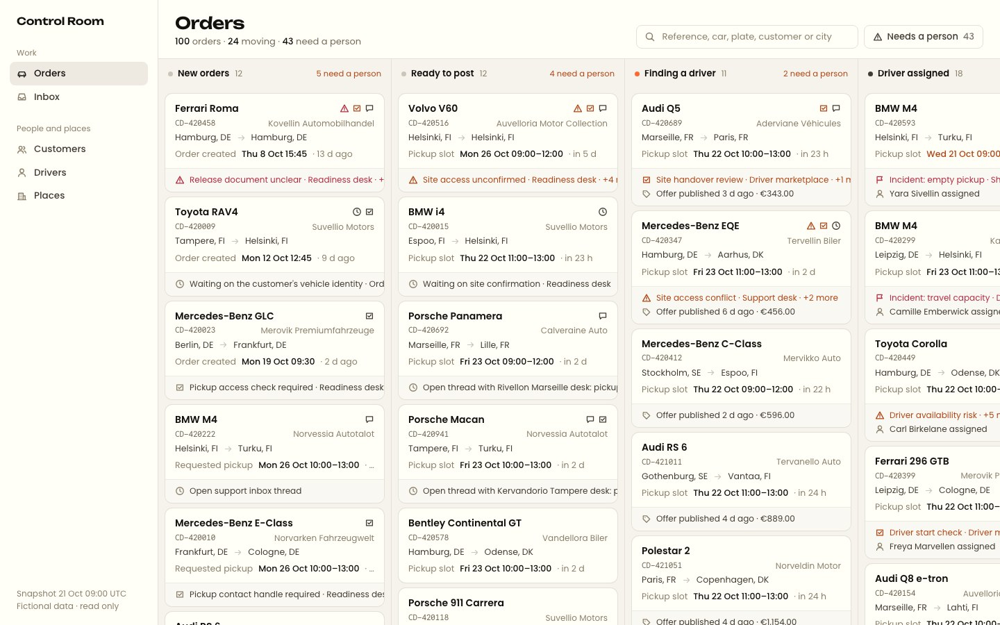
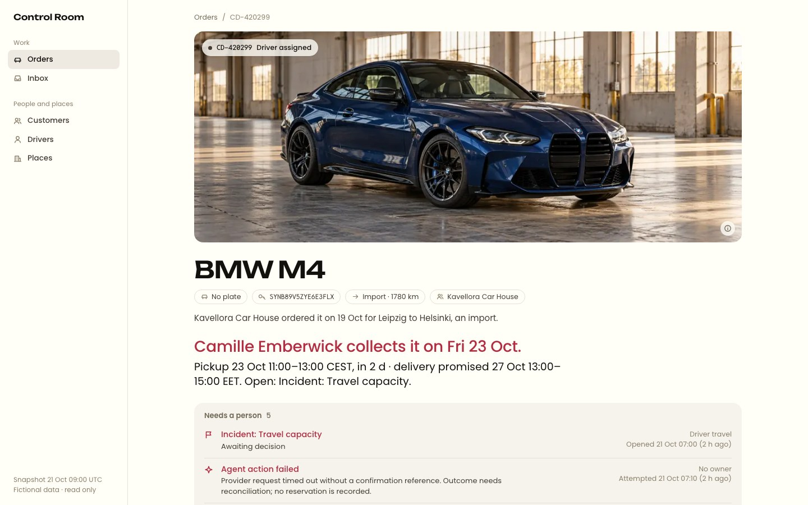
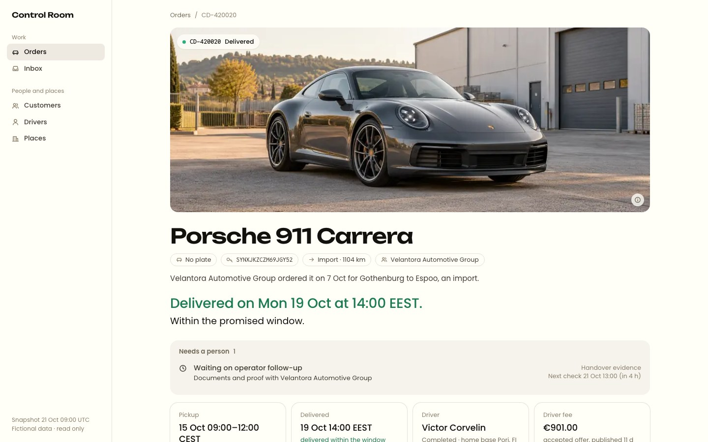
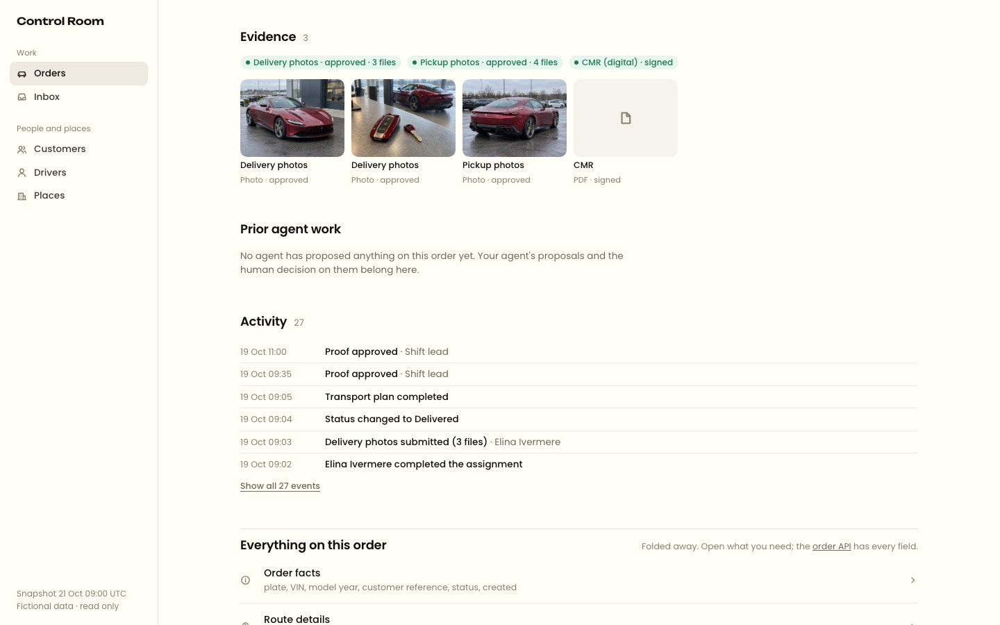
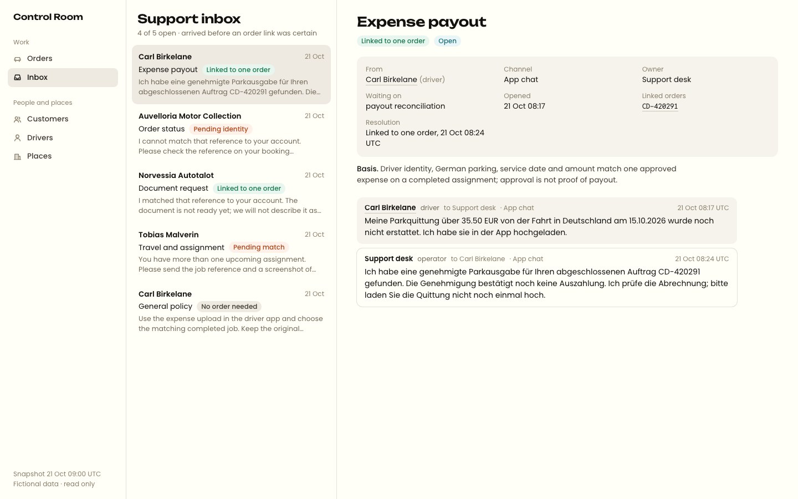

# Fictional starting screens

These are screenshots of the optional starter running on the synthetic data.
They are **not** screenshots of Bahn's current or planned Portal. The board,
the order record and the inbox are familiar starting points, not the expected
final design.

The board shows every order in its lane. Orders that need a person sort first,
then the date that decides the next step. The work line under a card is
derived from open alerts, work items, conversations and agent proposals; a quiet
card is not a verified safe order.

An order record opens with the model illustration, the car, a few facts, one
sentence of context and one headline about the situation. The first record is
a booked import with an acknowledged but unresolved ferry alert, a failed agent
action and a proposal still awaiting review. The second is a delivered import
whose ferry tracking-gap alert was resolved; a documents thread still waits on
a person. Everything else on an order is folded away under "Everything on this
order". The underlying messages, alerts and event histories are in the
dataset. A team may choose to show these cases very differently.

The third order screen shows the evidence of a delivered order: proof and
document states as chips, then the generated sample files. The sample files
and the structured proof records provide different kinds of evidence.

The support inbox holds messages that arrived before an order link was
certain. A candidate order is a hypothesis; only a linked order is confirmed.

